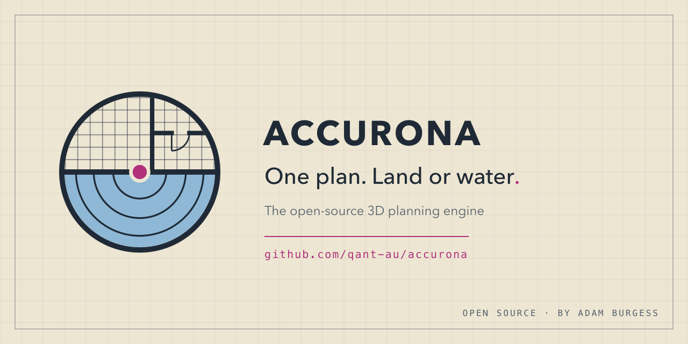

<p align="center">
  
</p>

# Accurona

Accurona is an open-source 3D planning engine. You draw a plan at true scale and see it
in 3D, and the same engine is being built to handle boats as well as buildings: a house
plan on land, or a hull, its decks and its equipment on the water.

It is an intentionally maintained fork of [NeonPlan 3D](https://github.com/Mastershort/neonplan3d)
by Mastershort (MIT). Upstream releases are merged in on a schedule, and there is no plan
to merge Accurona back: it is going somewhere a house-planning project would not carry.
See [NOTICE](NOTICE) for the credit and [LICENSE](LICENSE) for the terms.

## Status

Early. The engine is NeonPlan 3D 1.23.1's plan model, editor and 3D view, under its own
name, and it runs in two hosts:

- **Standalone**, with no Home Assistant anywhere: a plan kept in the browser, embeddable
  in any page (see [Embedding](#embedding)). This is the base everything else builds on.
- **Home Assistant**, as an optional integration that installs **beside** NeonPlan 3D
  without either one touching the other: its own integration domain (`accurona`), panel,
  card, custom elements, storage and static path.

What stays compatible with NeonPlan 3D:

- **Plans and backups** move between the two in both directions (same file formats).
- **Furniture packs** (`.fp3dpack`) signed by Mastershort load and are checked the same way.

## Where it is going

1. **Accurate hulls.** A hull interface built on cross-sections at stations, then a
   library of real hull families (fin-keel sloop, semi-displacement and planing
   cruisers, RIB, catamaran, launch) that you adjust to your own boat's measurements.
2. **Live data from outside.** The standalone host takes a signal source; Signal K is the
   first one, and once the marine work is in, a Signal K Server plugin installable from
   its app store.
3. **A first-run wizard**, once there is a library of boats and equipment to pick from:
   read the boat's details from Signal K, pick a hull, confirm the equipment, and land on
   your boat on the water in 3D, as an ordinary plan the editor then refines.

## Embedding

```sh
cd frontend && npm ci && npm run build && node ../fork/build-standalone.mjs
```

`dist/standalone/` then holds the engine and `accurona-host.js`. Serve the folder over
HTTP; `index.html` is a working example. In your own page:

```js
import { mountAccurona, browserStore } from "./accurona-host.js";

const planner = await mountAccurona(document.querySelector("#plan"), {
  store: browserStore("my-plan"), // or memoryStore(), or your own PlanStore
  // signals: a SignalSource for live data; staticSignals() is the simplest
  // homeAssistant: true shows the parts that need a Home Assistant behind the host (off by default)
});
```

The plan store and the signal source are interfaces (`frontend/src/host/types.ts`), so a
server-side store or a live data feed plugs in without touching the engine.

## Hulls

The hull code is in `frontend/src/hull/`: hulls as sections at stations, the Ship-D
parameterisation, round hulls and pontoons, RIB tubes, underwater parts, hydrostatics, and
stability at any heel and trim. The same build puts a hull viewer in
`dist/standalone/hulls.html`: every hull in the catalogue in 3D on the water, with its
numbers, a heel slider that floats it there with its load, and its righting-lever curve.
`hulls.html?hull=<name>` opens one.

## Install (Home Assistant)

Accurona is not yet published to HACS. Until it is, add this repository to HACS as a
custom repository (type: integration), or copy `custom_components/accurona` into your
Home Assistant configuration. The upstream manual covers the editor itself:
[docs/manual.md](docs/manual.md).

## Development

- Frontend in `frontend/` (Lit 3, TypeScript, three.js): `npm ci`, then `npm test`,
  `npm run typecheck`, `npm run build`. The built bundles are committed under
  `custom_components/accurona/frontend/`, and CI fails when they are stale.
- Home Assistant integration in `custom_components/accurona/` (Python 3.13):
  `pip install -r requirements_test.txt ruff mypy`, then `pytest -q`, `ruff check`,
  `ruff format --check`, `mypy custom_components/accurona`.
- The fork's own tooling is in [`fork/`](fork/). The rename from upstream's identity is
  a script, [`fork/identity.py`](fork/identity.py), re-run after every upstream merge.

## Licence

MIT. Copyright (c) 2026 Adam Burgess, and Copyright (c) 2026 Mastershort for NeonPlan 3D,
on which Accurona is based.
